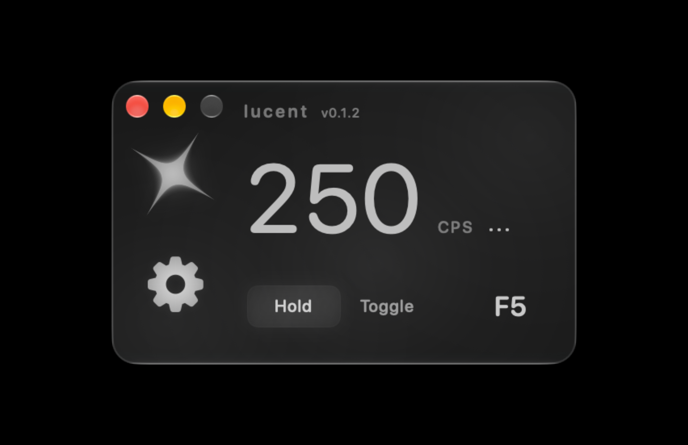

# lucent

**Early release:** lucent is my first native macOS app. It has had limited testing, so long-term stability is still unproven.

**Source languages:** Swift 89.1% · Python 8.3% · Shell 2.3% · HTML 0.3%

I couldn't find a native macOS autoclicker I liked, so I made my own.

[**Download lucent (.dmg)**](https://github.com/feowur/lucent/releases/latest/download/lucent.dmg)

### Features

- Mouse and key repeating up to 250 CPS, with Hold or Toggle.
- Configurable shortcuts, timing and repeat limits.
- Native glass, image/GIF backgrounds and manual updates.

### Installation

Grab `lucent.dmg`, open it, and drag **lucent** into **Applications**.

macOS might complain the first time since lucent isn't notarized yet. If it does, try opening it, then head to **System Settings → Privacy & Security → Open Anyway**.

To uninstall, just drag **lucent** from **Applications** to the Trash. That's it.

---

Made by [feowur](https://github.com/feowur).
